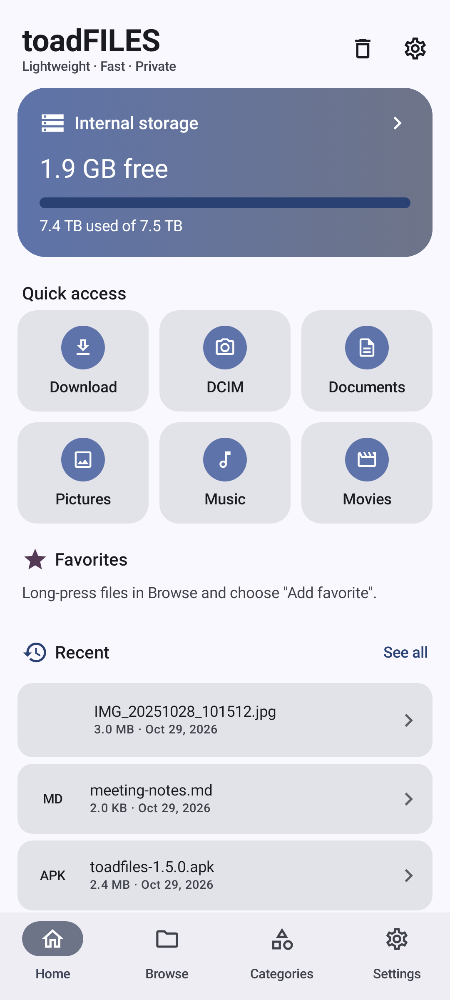
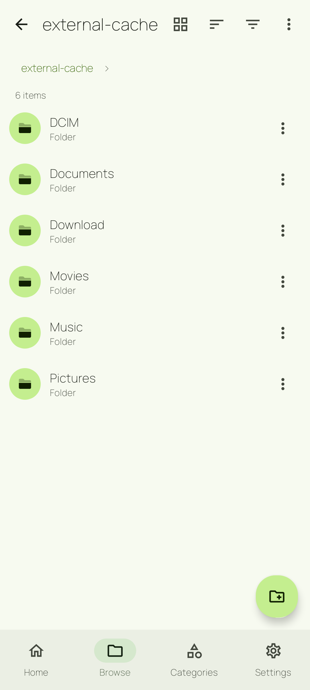
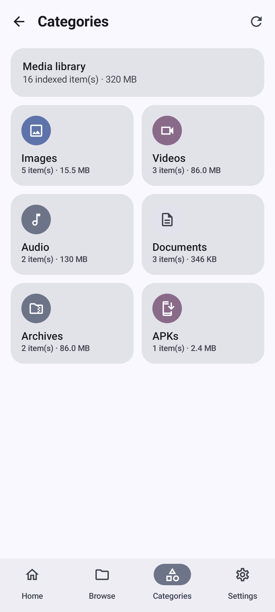
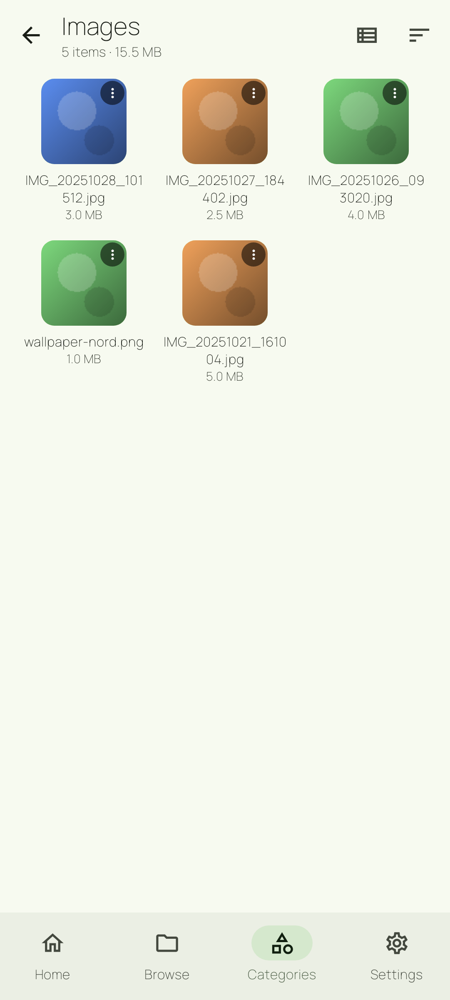
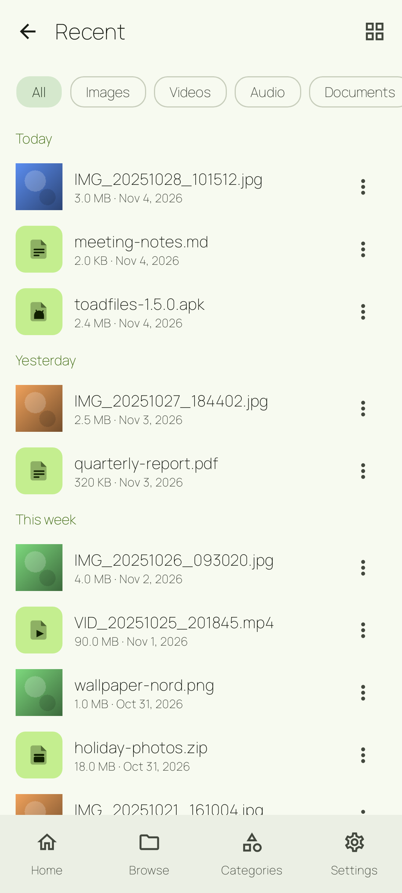
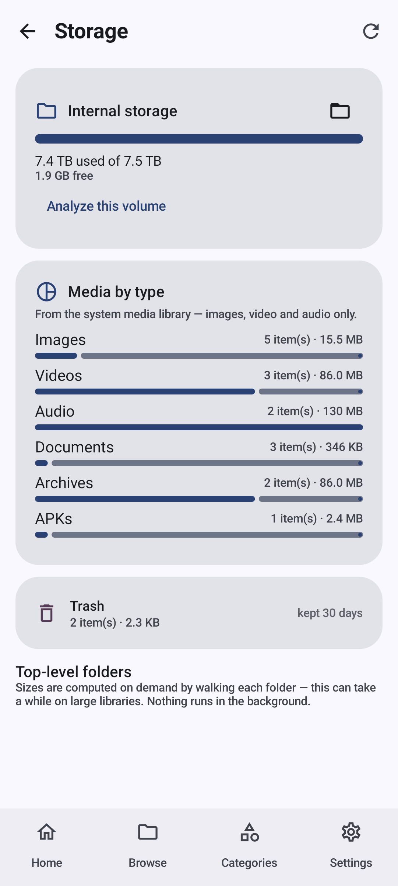
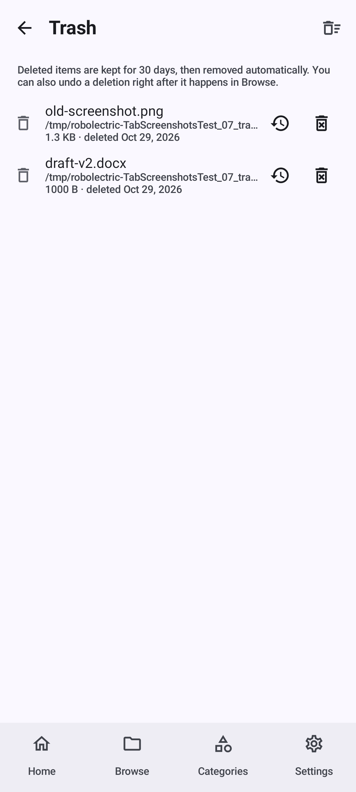
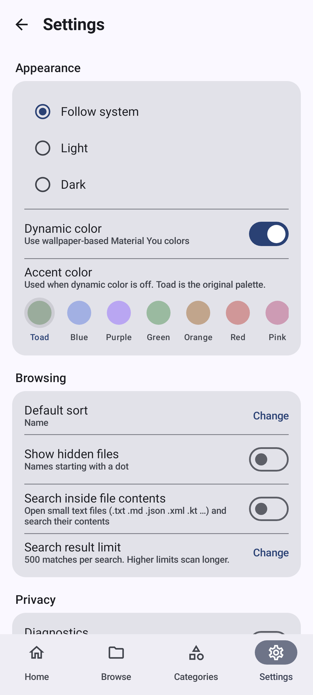

# toadFILES

[](https://github.com/dukeoftoad/toadFILES/actions/workflows/android.yml)

A file manager for Android that stays out of your way. No ads, no tracking, no cloud, and no internet permission at all, so it can't phone home even if it wanted to.

I built it because I wanted something that opens fast, browses real folders instead of a fake "recent files" view, and doesn't nag me. It works on actual files in actual directories and tells you honestly when something fails.

## Screenshots

Real screenshots of the app — captured from the actual Compose UI running on the JVM via [Roborazzi](https://github.com/takahirom/roborazzi), so they stay in sync with the code.

| Home | Browse | Categories | Images |
|:---:|:---:|:---:|:---:|
|  |  |  |  |

| Recent | Storage | Trash | Settings |
|:---:|:---:|:---:|:---:|
|  |  |  |  |

## What it does

- Browse any readable folder on internal storage, SD cards and USB drives. Breadcrumbs, a hidden-files toggle right in the toolbar, list or grid.
- Search the current folder tree. There's a settings toggle to also search inside small text files, and you can set your own result limit.
- Copy, move, rename, zip/unzip, delete. Deleted items land in a per-volume trash and stay there for 30 days, with undo. Deleting forever always asks first.
- Sort by name, size, date or type. Filter down to documents, images, videos, audio, archives or APKs.
- Favorites that follow renames and moves, and get cleaned up when the target is gone.
- Long-press a file to start multi-select (Google-Files style); the row's ⋮ button opens the full action sheet: open, share, rename, copy, move, delete, details, zip, favorite, pin to Home, copy path, open with.
- Multi-select in Browse, Categories and Recent — batch share, delete, zip (Browse) with select-all support. Zipping always asks for the archive name first, and tapping a zip offers to extract it right there.
- Sharing is the real thing: Android's standard share sheet (ACTION_SEND) hands the files to whichever app you pick. Single or multiple. toadFILES itself still uploads nothing.
- Opening a file uses the system "Just once / Always" chooser, so you can pin a default app per file type if you like.
- Tapping an APK offers a real install handoff; if Android's "Install unknown apps" toggle is off, the app walks you straight to it.
- A Categories tab that reads the system media library: a grid with per-type icons, item counts and sizes. Images and videos drill into a thumbnail gallery; every entry opens, shares, or deletes to trash — trashed files are hidden from Categories and Recent.
- Quick access on Home is yours: pin folders from Browse, edit them with the ＋ button, long-press to remove — and folders you open often show up automatically as "most used".
- Recent files are fully actionable: open, share, show in folder, delete, details — not just a list. Type filter tabs (All / images / videos / audio / docs / archives / APKs) narrow it down.
- Home is a proper dashboard: a hero storage card with free space, quick-access folders with icons, favorites, and a recent feed.
- Storage screen with per-volume cards, a media-by-type breakdown, trash usage, and an on-demand biggest-folders analyzer.
- Material You dynamic color on Android 12+, or pick one of seven accent colors (toad, blue, purple, green, orange, red, pink) when dynamic color is off.

Encrypted vault (Keystore plus biometrics) is on the list. It'll show up once I'm confident it can be done right.

## Install

Grab the APK from the [Releases](https://github.com/dukeoftoad/toadFILES/releases) page. Android 8.0 or newer is required. On Android 11+ the app asks for "All files access", which is the standard permission for a file manager.

## Building from source

```
./gradlew :app:assembleDebug
./gradlew :app:testDebugUnitTest
```

Android Studio (Koala or newer) works too. Tests are plain JVM tests running on Robolectric, so no emulator is needed.

The instrumentation suite (`./gradlew :app:connectedDebugAndroidTest`) does need a device or emulator, so CI runs it for you on emulators for API 29, 33 and 36 on every push and pull request — the same gate lint, unit tests and APK assembly go through.

To regenerate the README screenshots after UI changes:

```
./gradlew :app:recordRoborazziDebug
cp app/roborazzi/*.png docs/screenshots/
```

## Project layout

Nothing clever here.

```
app/src/main/java/com/toadfiles/app/
├── domain/    # pure Kotlin: models, sorting, path safety, file ops, ZIP handling, AccentColor
├── data/      # java.io, MediaStore, DataStore wrappers
├── ui/        # Compose screens and shared components (FileActionSheet, MediaActionSheet, dialogs)
│   ├── about/      # About page (version/build, storage, credits, changelog, diagnostics)
│   ├── home/       # Home dashboard: hero storage card, quick access, favorites, recent feed
│   ├── browse/     # Folder listing: search, filter, sort, multi-select, zip, clipboard
│   ├── categories/ # Media-library grid + thumbnail drill-ins with multi-select
│   ├── recent/     # Actionable recent files
│   └── theme/      # ToadTheme + AccentPalettes (7 hand-tuned light/dark color schemes)
├── util/      # share/open/install intents, video thumbnails
└── ToadApp.kt # DI container, hand-rolled on purpose
```

Two decisions worth knowing about: nothing touches the filesystem until a screen asks for it (no startup scan), and every copy/move/delete/extract reports what actually happened per item, failures included. No Hilt, no Firebase, no network stack. Coil pulls in thumbnails and that's about it.

## License

GPL-3.0. See [LICENSE](LICENSE).
